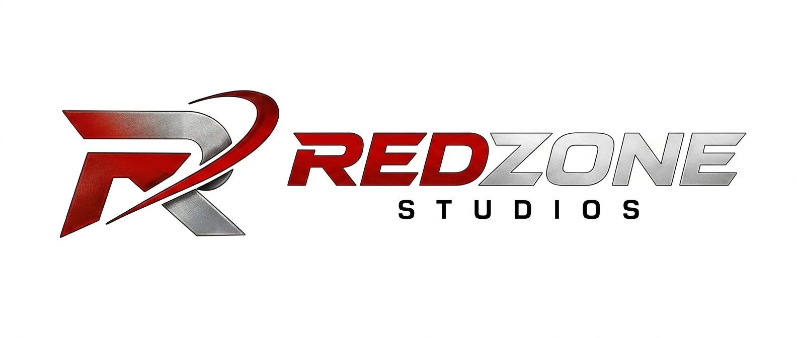

<!-- Üst Geniş Banner (600px) -->

  
>

 

### 🔴 About Redzone Studios
Welcome to **Redzone Studios**! Based in **Azerbaijan**

* 🔭 **Currently working on:** [Redzone-Terminal](https://github.com) — Next-gen Windows Terminal command center
* ⚡ **Focus Areas:** System Telemetry, PowerShell Automation, UI/UX Customization & Performance Tools

 

### 🌐 Socials

  
  &nbsp;&nbsp;&nbsp;
  

 

### 🚀 Latest Repositories (Auto-Updated)

* **[RedzoneStudiosAz/Redzone-Terminal](https://github.com/RedzoneStudiosAz/Redzone-Terminal)** — Turn your Windows Terminal into a sleek crimson-black command center. One-click setup for PowerShell 7, custom Acrylic theme, and an ultra-fast 10-language live system telemetry dashboard. *(⭐ 1)*

 

### ⚡ Recent Activity

* Contributed to **[RedzoneStudiosAz/Redzone-Terminal](https://github.com/RedzoneStudiosAz/Redzone-Terminal)** (1 day ago)

 

### 📊 GitHub Stats

  

